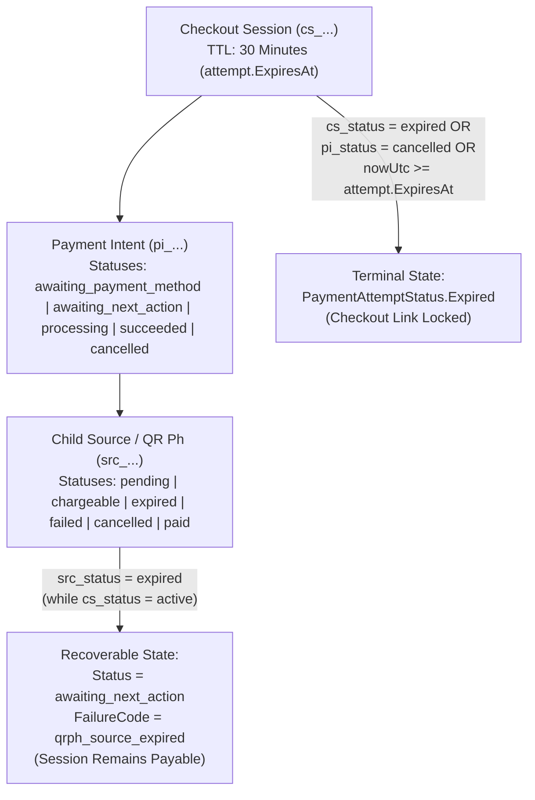

# PayMongo Payment-Method Selection and Lifecycle Review

## 1. Executive Summary

This document captures the architectural analysis and implementation rules for the R.G.E. Accounting Portal's PayMongo Checkout Session integration across both the ASP.NET Core 10 Modular Monolith (`Backend/`) and the Next.js App Router (`Frontend/`).

Production runtime telemetry (`order_id=b9a642b9-50a0-4111-8715-4313140c0ad1`, `cs_fafe58a436adb3bc3aee6274`, and `cs_c80a1c0c936dd488399bc507`) identified four core issues that previously caused active checkout sessions to prematurely lock or fail to synchronize in real time:

1. **Conflation of Underlying QR Ph Source (`src_...`) Expiry with Checkout Session (`cs_...`) Expiry**:
   - Inside a PayMongo Hosted Checkout Session (`cs_...`), a dynamic QR Ph code (`src_...`) has a short validity window (~90–120 seconds), whereas the parent Checkout Session remains `active` for 30 minutes (`1800s`).
   - Previously, `PayMongoClient.TryInspectUnderlyingSourceAsync` inspected `GET /v1/sources/{src_id}` and overwrote the active Checkout Session's status with `Status = "expired"` (`FailureCode = "source_expired"`) as soon as the QR code timed out.
   - `PaymentExpirationWorker` then observed `remote_status = "expired"` with `remaining_sec = 1685` still remaining on the session, terminally locked the local `PaymentAttempt` as `Expired`, called `POST /v1/checkout_sessions/{cs_id}/expire`, and broadcast `Expired` over SignalR.
2. **Passive `/poll` Endpoint Default (`0.11ms` No-Op)**:
   - `GetPaymentEndpoint.cs` mapped `POST /api/v1/payments/{payment_id}/poll` with `auto_reconcile ?? false`, and `use-paymongo-realtime-sync.ts` invoked `/poll` without `?auto_reconcile=true`.
   - Every 3-second frontend poll and window-focus trigger returned a cached database row in `0.11ms` instead of reconciling with PayMongo.
3. **Unconnected `/checkout?order_id=...` Hydration & Stale `sessionStorage` Attachment**:
   - `Frontend/app/checkout/page.tsx` checked `data.latest_payment_attempt_id` (which did not match the backend `OrderDto.latest_attempt` contract) and blindly hydrated expired `sessionStorage` entries (`rge_checkout_attempt_${orderId}`).
4. **Ambiguous Payment-Method Selector Taxonomy (`GCash / Maya` vs. `QR Ph`)**:
   - Combining GCash and Maya into a single `"GCash / Maya"` button mapped only to `["gcash"]` (omitting `"paymaya"`) and blurred the distinction between scanning a QR Ph code with a banking/wallet app versus authenticating directly in the GCash or Maya e-wallet redirect flow.

---

## 2. Customer-Facing Payment-Method Taxonomy

To eliminate ambiguity between **QR Ph scanning** and **direct e-wallet authorization**, the checkout selector (`Frontend/app/checkout/page.tsx`) presents **four distinct customer-facing choices** that map 1-to-1 to PayMongo `payment_method_types`:

| Customer-Facing Option | Internal Code | PayMongo `payment_method_types` | Customer Helper Description |
| :--- | :--- | :--- | :--- |
| **QR Ph — Scan to Pay** | `qrph` | `["qrph"]` | *"Scan the QR code using GCash, Maya, or another supported bank/e-wallet app."* |
| **GCash — E-wallet** | `gcash` | `["gcash"]` | *"Continue to GCash to authorize your payment."* |
| **Maya — E-wallet** | `paymaya` | `["paymaya"]` | *"Continue to Maya to authorize your payment."* |
| **Credit / Debit Card** | `card` | `["card"]` | *"Pay using an eligible Visa or Mastercard."* |

> [!NOTE]
> For backward compatibility with historical orders or integrations, `PaymentMethod.Normalize` and `PayMongoClient.MapPaymentMethodTypes` continue to accept `"gcash_maya"` and map it to `["gcash", "paymaya"]`.

---

## 3. Checkout Session vs. Payment-Method / QR Source Expiry State Machine

A PayMongo Hosted Checkout Session (`cs_...`) contains three distinct lifecycle layers:

### 3.1 Invariants Enforced in `PayMongoClient.cs` & `PaymentExpirationWorker.cs`
1. **Child Source Expiry on an Active Checkout Session is Recoverable**:
   - When `sessionData.Id` is a Checkout Session (`cs_...`) and `sessionData.Attributes.Status == "active"`, an underlying `src_...` with `status == "expired"` (or a `payment_intent` resetting from `awaiting_next_action` back to `awaiting_payment_method` without `last_payment_error`) returns:
     - `Status = "awaiting_next_action"`
     - `FailureCode = "qrph_source_expired"`
     - `FailureMessage = "Underlying source {srcId} expired while Checkout Session {csId} remains active."`
   - Neither `PollAndReconcileHandler` nor `PaymentExpirationWorker` marks the `PaymentAttempt` as `Expired` or calls `ExpireCheckoutSessionAsync(cs_...)` while the Checkout Session itself remains active and before `attempt.ExpiresAt`.
2. **Authoritative Checkout Session Expiry**:
   - A Checkout Session (`cs_...`) transitions to `PaymentAttemptStatus.Expired` only when:
     - `checkout_session.attributes.status == "expired"`,
     - `payment_intent.attributes.status == "cancelled"`,
     - An authoritative `checkout_session.expired` / `qrph.expired` webhook event arrives with expired session state, or
     - The local 30-minute deadline (`attempt.ExpiresAt <= nowUtc`) is reached and verified against PayMongo.
3. **Direct Legacy Source (`src_...`) Expiry**:
   - When `PaymentAttempt.ProviderPaymentId` itself is a standalone `src_...` resource (`InspectDirectSourceAsync`), `src_status == "expired"` remains terminal (`Status = "expired"`, `FailureCode = "source_expired"`).

---

## 4. Real-Time Synchronization & URL Hydration Architecture

### 4.1 Active Polling on `POST /api/v1/payments/{payment_id}/poll`
- `GetPaymentEndpoint.cs` defaults `auto_reconcile` to `true` for `POST /api/v1/payments/{payment_id}/poll` and supports `force_reconcile=true`.
- `PollAndReconcileHandler.cs` uses a `3-second` gateway cooldown window (`CooldownWindow = TimeSpan.FromSeconds(3)`) and bypasses the cooldown whenever `ForceReconcile` or `ClientReportedRedirectStatus` is present.
- `use-paymongo-realtime-sync.ts` sends `POST /api/v1/payments/{id}/poll?auto_reconcile=true` on scheduled 3-second intervals and appends `&force_reconcile=true` on `mount_or_reload`, `window_focus`, `tab_visibility_visible`, `manual_debug_button`, and `countdown_reached_zero`.

### 4.2 Authoritative `/checkout` URL Hydration & Cancel Redirect Handling
- When navigating to `/checkout?order_id={orderId}` or `/checkout?order_id={orderId}&attempt_id={attemptId}`:
  - `Frontend/app/checkout/page.tsx` fetches `GET /api/v1/orders/{orderId}` and inspects `data.latest_attempt` and `data.attempts`.
  - If a cached `sessionStorage` attempt (`rge_checkout_attempt_${orderId}`) is already terminal (`expired`, `failed`, `cancelled`) or past its `expires_at` timestamp, it is automatically evicted so the customer is never trapped on a locked session.
  - While an attempt is in `RequiresAction` (including when `failureCode === "qrph_source_expired"`), `PayMongoCheckoutGuard` displays a recoverable notice, keeps the **Open PayMongo Gateway** button active while time remains, and offers a **Change Payment Method or Start New Checkout Session** action.
- **Cancel Redirect (`?cancelled=true`) & Abandoned Session Cleanup**:
  - When a customer clicks Back/Cancel on PayMongo and returns to `/checkout?order_id={orderId}&cancelled=true`, `checkout/page.tsx` passes `clientReportedRedirectStatus="cancelled"` to `PayMongoCheckoutGuard` and `usePayMongoRealtimeSync`.
  - `usePayMongoRealtimeSync` appends `&client_reported_redirect_status=cancelled` to `POST /api/v1/payments/{id}/poll`.
  - `PollAndReconcileHandler` queries PayMongo first (preventing a spoofed redirect from overwriting a paid session) and, if unpaid, transitions the attempt to `Failed` (`source_cancelled`) and calls `ExpireCheckoutSessionAsync(cs_...)` (`POST /v1/checkout_sessions/{cs_id}/expire`).
  - Similarly, when the customer clicks **Change Payment Method or Start New Checkout Session** (`handleResetAttempt`) or initiates a new payment attempt on the same order (`InitiateAttemptHandler`), any prior non-terminal attempt is superseded/expired locally and on PayMongo (`superseded_by_new_attempt`) so `PaymentExpirationWorker` stops polling abandoned sessions.

---

## 5. Interpret Resources Separately (`cs_...`, `pi_...`, `src_...`)

Production logs (`2026-11-12T11:40:24Z` to `11:42:14Z`) demonstrated two separate contexts when a child QR/source expires inside an active Checkout Session:

| Resource | Production Example | State | Meaning |
| :--- | :--- | :--- | :--- |
| **QR / Source Payment Resource** | `src_trsEs5mZdwDDb2UwWyQ91goT` / `src_2d7NdAhpYZEwsNaqDb1qjw4T` | `expired` | That specific payment source / QR code is no longer usable |
| **Payment Intent** | `pi_rZHtZVfLp1kSXf9FEK3gcbKW` / `pi_sBTzFzg7tcZZhN44MSQoTEvD` | `awaiting_next_action` | Waiting for customer authorization or retry |
| **Checkout Session** | `cs_1c368511968843ba195aedd8` / `cs_d82fafa0fd3d9d5aaa9e8ad2` | `active` | Hosted checkout remains open and can accept a retry |
| **Hosted URL** | `https://checkout.paymongo.com/1c368511968843ba195aedd8` | Still opens | Expected while the Checkout Session remains `active` |

### 5.1 Why the PayMongo-Hosted Checkout Page Can Still Show a Timer
- **Merchant Application Context**: The backend polls `GET /v1/checkout_sessions/{cs_id}` and `GET /v1/sources/{src_id}`, observes `src_status=expired` while `cs_status=active`, records `qrph_source_expired`, and renders a recoverable notice in the merchant UI.
- **PayMongo-Hosted Context (`checkout.paymongo.com`)**: PayMongo controls the hosted checkout page DOM and its displayed timer. A backend `GET /v1/sources/{src_id}` retrieval is a read operation—it does not remotely close or mutate the customer's open `checkout.paymongo.com` tab. Only calling `POST /v1/checkout_sessions/{cs_id}/expire` expires the hosted session on PayMongo.

---

## 6. Why Backend Polling Does Not Create PayMongo Webhook Deliveries

1. **Outbound Pull vs. Inbound Push**:
   - Backend logs showing `GET https://api.paymongo.com/v1/checkout_sessions/cs_...` and `GET https://api.paymongo.com/v1/sources/src_...` are outbound REST queries initiated by the merchant server.
   - Outbound `GET` requests never create entries in PayMongo's **Webhook Deliveries** dashboard and never populate `GET /api/v1/admin/webhook-events`.
2. **Webhook Events Reference Matrix**:

| Event | Meaning |
| :--- | :--- |
| `checkout_session.payment.paid` | Hosted Checkout Session payment succeeded |
| `payment.paid` | Payment succeeded |
| `payment.failed` | Payment failed |
| `source.chargeable` | E-wallet / source authorized and ready to be charged |
| `qrph.expired` | QR Ph code expired before payment was completed |
| `qr.paid` / `qr.expired` | Dynamic QR payment paid / expired |
| *(Checkout Session expiry)* | **No webhook sent by PayMongo** — record from the Expire endpoint response |

---

## 7. Webhook Subscription Verification & Diagnostics

When PayMongo's dashboard shows **No event deliveries found** and `GET /api/v1/admin/webhook-events` returns `[]` (`bytes=2`), verify:
1. **Test vs. Live Mode Separation**: A `test` mode transaction (`sk_test_...`, `livemode: false`) only triggers `test` webhooks; a `live` mode transaction (`sk_live_...`, `livemode: true`) only triggers `live` webhooks.
2. **Subscribed Events List**: Ensure the registered webhook includes all canonical events:
   - `checkout_session.payment.paid`
   - `payment.paid`
   - `payment.failed`
   - `source.chargeable`
   - `qrph.expired`
3. **Diagnostic & Auto-Setup Endpoints**:
   - `GET /api/v1/admin/webhooks/paymongo/status`: Queries `GET https://api.paymongo.com/v1/webhooks` and reports `key_mode` (`test` vs `live`), `target_url`, registered webhooks, `mode_matches_key`, and `missing_canonical_events`.
   - `POST /api/v1/admin/webhooks/paymongo/setup`: Creates or updates (`PUT /v1/webhooks/{id}`) the domain's webhook so all 5 canonical events (`checkout_session.payment.paid`, `payment.paid`, `payment.failed`, `source.chargeable`, `qrph.expired`) are subscribed and enabled.

---

## 8. 10-Step Transaction Diagnostic Procedure

To audit any transaction (`cs_...`, `pi_...`, `src_...`) end-to-end:
1. Retrieve `GET https://api.paymongo.com/v1/checkout_sessions/{cs_id}` and record `data.attributes.status` (`active`, `expired`, `paid`) and `data.attributes.livemode`.
2. Retrieve `GET https://api.paymongo.com/v1/payment_intents/{pi_id}` and record `data.attributes.status` and `last_payment_error`.
3. Retrieve `GET https://api.paymongo.com/v1/sources/{src_id}` and record `data.attributes.status` and `created_at` / `updated_at`.
4. Confirm all three IDs belong to the same transaction chain (`cs_...` -> `pi_...` -> `src_...`).
5. Retrieve `GET https://api.paymongo.com/v1/webhooks` (or call `GET /api/v1/admin/webhooks/paymongo/status`).
6. Confirm a webhook exists in the same `livemode` (`test` vs `live`) as the transaction.
7. Confirm the webhook `status` is `enabled` and its `url` points to `https://<host>/api/v1/webhooks/paymongo`.
8. Confirm `events` includes `qrph.expired` (for QR expiry notifications) and `checkout_session.payment.paid` / `payment.paid` / `payment.failed` / `source.chargeable`.
9. Trigger a controlled test event in the same mode and verify `POST /api/v1/webhooks/paymongo` logs `[PAYMONGO-WEBHOOK-INBOUND]`.
10. Verify `GET /api/v1/admin/webhook-events` returns the persisted event row rather than `[]`.

---

## 9. Architectural Invariants: Separation of QR Source vs. Checkout Session

Based on the official PayMongo documentation ([PayMongo — Checkout Session and QR Ph lifecycle](https://docs.paymongo.com/docs/payment-channels-key-concepts)):

### 9.1 Summary of Invariants
1. **Never Call `ExpireCheckoutSessionAsync` Solely Because a QR Source Expired**:
   - When a QR code or e-wallet source (`src_...`) expires (`src_status=expired`), the Payment Intent resets to `awaiting_payment_method` while the parent Checkout Session (`cs_...`) remains `active`.
   - The merchant application must **never** call `POST /v1/checkout_sessions/{id}/expire` simply because the source expired. Doing so converts a recoverable payment-method expiration into a terminal session termination.
   - The customer can simply reopen or stay on the Hosted Checkout page and generate a new QR code or select another payment method.
2. **Recoverable Local Classification (`awaiting_next_action` / `qrph_source_expired`)**:
   - The gateway returns `Status = "awaiting_next_action"` and `FailureCode = "qrph_source_expired"`.
   - The UI displays a recoverable notification: *"QR Code Timed Out — Checkout Session Still Active"*.
   - The session countdown reflects the actual remaining session time; it does not snap to `00:00` unless the session's overall deadline is reached.
3. **Poll Throttling & Cooldown Distinction**:
   - Differentiate fast cached database reads from remote PayMongo gateway reconciliations.
   - Respect a 3-second cooldown window for ordinary automatic polling ticks, but bypass cooldown for user-initiated triggers (`force_reconcile=true`, window focus, tab visibility change, or cancel redirects).
4. **SignalR Connection & Polling Lifecycle**:
   - Stop payment-status polling and teardown SignalR only upon reaching a terminal state (`paid`, `succeeded`, `failed`, `expired`, `cancelled`).
   - For recoverable states (`RequiresAction`), maintain controlled polling and keep the active session open.
   - Maintain stable SignalR connection dependencies to prevent reconnection loops.
5. **Webhook Correlation & Subscriptions**:
   - Ensure canonical webhook events (`checkout_session.payment.paid`, `payment.paid`, `payment.failed`, `source.chargeable`, `qrph.expired`) are registered.
   - PayMongo does not send a webhook for Checkout Session expiration; that must be recorded when explicitly expired via the API or evaluated during reconciliation.

