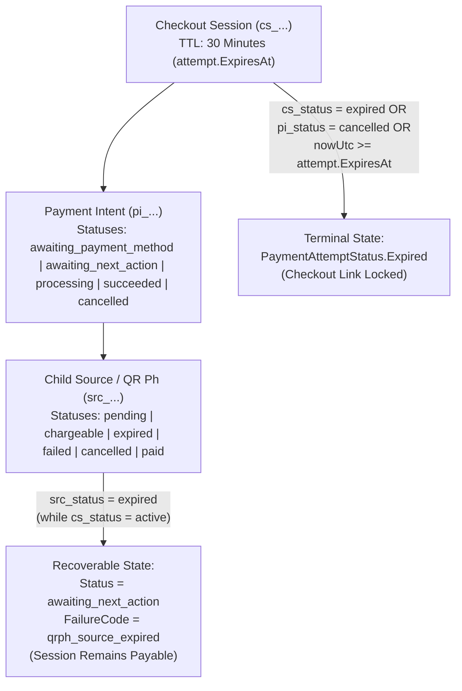

# PayMongo Payment-Method Selection and Lifecycle Review

## 1. Executive Summary

This document captures the architectural analysis and implementation rules for the R.G.E. Accounting Portal's PayMongo Checkout Session integration across both the ASP.NET Core 10 Modular Monolith (`Backend/`) and the Next.js App Router (`Frontend/`).

Production runtime telemetry (`order_id=b9a642b9-50a0-4111-8715-4313140c0ad1`, `cs_fafe58a436adb3bc3aee6274`, and `cs_c80a1c0c936dd488399bc507`) identified four core issues that previously caused active checkout sessions to prematurely lock or fail to synchronize in real time:

1. **Conflation of Underlying QR Ph Source (`src_...`) Expiry with Checkout Session (`cs_...`) Expiry**:
   - Inside a PayMongo Hosted Checkout Session (`cs_...`), a dynamic QR Ph code (`src_...`) has a short validity window (~90–120 seconds), whereas the parent Checkout Session remains `active` for 30 minutes (`1800s`).
   - Previously, `PayMongoClient.TryInspectUnderlyingSourceAsync` inspected `GET /v1/sources/{src_id}` and overwrote the active Checkout Session's status with `Status = "expired"` (`FailureCode = "source_expired"`) as soon as the QR code timed out.
   - `PaymentExpirationWorker` then observed `remote_status = "expired"` with `remaining_sec = 1685` still remaining on the session, terminally locked the local `PaymentAttempt` as `Expired`, called `POST /v1/checkout_sessions/{cs_id}/expire`, and broadcast `Expired` over SignalR.
2. **Passive `/poll` Endpoint Default (`0.11ms` No-Op)**:
   - `GetPaymentEndpoint.cs` mapped `POST /api/v1/payments/{payment_id}/poll` with `auto_reconcile ?? false`, and `use-paymongo-realtime-sync.ts` invoked `/poll` without `?auto_reconcile=true`.
   - Every 3-second frontend poll and window-focus trigger returned a cached database row in `0.11ms` instead of reconciling with PayMongo.
3. **Unconnected `/checkout?order_id=...` Hydration & Stale `sessionStorage` Attachment**:
   - `Frontend/app/checkout/page.tsx` checked `data.latest_payment_attempt_id` (which did not match the backend `OrderDto.latest_attempt` contract) and blindly hydrated expired `sessionStorage` entries (`rge_checkout_attempt_${orderId}`).
4. **Ambiguous Payment-Method Selector Taxonomy (`GCash / Maya` vs. `QR Ph`)**:
   - Combining GCash and Maya into a single `"GCash / Maya"` button mapped only to `["gcash"]` (omitting `"paymaya"`) and blurred the distinction between scanning a QR Ph code with a banking/wallet app versus authenticating directly in the GCash or Maya e-wallet redirect flow.

---

## 2. Customer-Facing Payment-Method Taxonomy

To eliminate ambiguity between **QR Ph scanning** and **direct e-wallet authorization**, the checkout selector (`Frontend/app/checkout/page.tsx`) presents **four distinct customer-facing choices** that map 1-to-1 to PayMongo `payment_method_types`:

| Customer-Facing Option | Internal Code | PayMongo `payment_method_types` | Customer Helper Description |
| :--- | :--- | :--- | :--- |
| **QR Ph — Scan to Pay** | `qrph` | `["qrph"]` | *"Scan the QR code using GCash, Maya, or another supported bank/e-wallet app."* |
| **GCash — E-wallet** | `gcash` | `["gcash"]` | *"Continue to GCash to authorize your payment."* |
| **Maya — E-wallet** | `paymaya` | `["paymaya"]` | *"Continue to Maya to authorize your payment."* |
| **Credit / Debit Card** | `card` | `["card"]` | *"Pay using an eligible Visa or Mastercard."* |

> [!NOTE]
> For backward compatibility with historical orders or integrations, `PaymentMethod.Normalize` and `PayMongoClient.MapPaymentMethodTypes` continue to accept `"gcash_maya"` and map it to `["gcash", "paymaya"]`.

---

## 3. Checkout Session vs. Payment-Method / QR Source Expiry State Machine

A PayMongo Hosted Checkout Session (`cs_...`) contains three distinct lifecycle layers:

### 3.1 Invariants Enforced in `PayMongoClient.cs` & `PaymentExpirationWorker.cs`
1. **Child Source Expiry on an Active Checkout Session is Recoverable**:
   - When `sessionData.Id` is a Checkout Session (`cs_...`) and `sessionData.Attributes.Status == "active"`, an underlying `src_...` with `status == "expired"` (or a `payment_intent` resetting from `awaiting_next_action` back to `awaiting_payment_method` without `last_payment_error`) returns:
     - `Status = "awaiting_next_action"`
     - `FailureCode = "qrph_source_expired"`
     - `FailureMessage = "Underlying source {srcId} expired while Checkout Session {csId} remains active."`
   - Neither `PollAndReconcileHandler` nor `PaymentExpirationWorker` marks the `PaymentAttempt` as `Expired` or calls `ExpireCheckoutSessionAsync(cs_...)` while the Checkout Session itself remains active and before `attempt.ExpiresAt`.
2. **Authoritative Checkout Session Expiry**:
   - A Checkout Session (`cs_...`) transitions to `PaymentAttemptStatus.Expired` only when:
     - `checkout_session.attributes.status == "expired"`,
     - `payment_intent.attributes.status == "cancelled"`,
     - An authoritative `checkout_session.expired` / `qrph.expired` webhook event arrives with expired session state, or
     - The local 30-minute deadline (`attempt.ExpiresAt <= nowUtc`) is reached and verified against PayMongo.
3. **Direct Legacy Source (`src_...`) Expiry**:
   - When `PaymentAttempt.ProviderPaymentId` itself is a standalone `src_...` resource (`InspectDirectSourceAsync`), `src_status == "expired"` remains terminal (`Status = "expired"`, `FailureCode = "source_expired"`).

---

## 4. Real-Time Synchronization & URL Hydration Architecture

### 4.1 Active Polling on `POST /api/v1/payments/{payment_id}/poll`
- `GetPaymentEndpoint.cs` defaults `auto_reconcile` to `true` for `POST /api/v1/payments/{payment_id}/poll` and supports `force_reconcile=true`.
- `PollAndReconcileHandler.cs` uses a `3-second` gateway cooldown window (`CooldownWindow = TimeSpan.FromSeconds(3)`) and bypasses the cooldown whenever `ForceReconcile` or `ClientReportedRedirectStatus` is present.
- `use-paymongo-realtime-sync.ts` sends `POST /api/v1/payments/{id}/poll?auto_reconcile=true` on scheduled 3-second intervals and appends `&force_reconcile=true` on `mount_or_reload`, `window_focus`, `tab_visibility_visible`, `manual_debug_button`, and `countdown_reached_zero`.

### 4.2 Authoritative `/checkout` URL Hydration
- When navigating to `/checkout?order_id={orderId}` or `/checkout?order_id={orderId}&attempt_id={attemptId}`:
  - `Frontend/app/checkout/page.tsx` fetches `GET /api/v1/orders/{orderId}` and inspects `data.latest_attempt` and `data.attempts`.
  - If a cached `sessionStorage` attempt (`rge_checkout_attempt_${orderId}`) is already terminal (`expired`, `failed`, `cancelled`) or past its `expires_at` timestamp, it is automatically evicted so the customer is never trapped on a locked session.
  - While an attempt is in `RequiresAction` (including when `failureCode === "qrph_source_expired"`), `PayMongoCheckoutGuard` displays a recoverable notice, keeps the **Open PayMongo Gateway** button active while time remains, and offers a **Change Payment Method or Start New Checkout Session** action.
